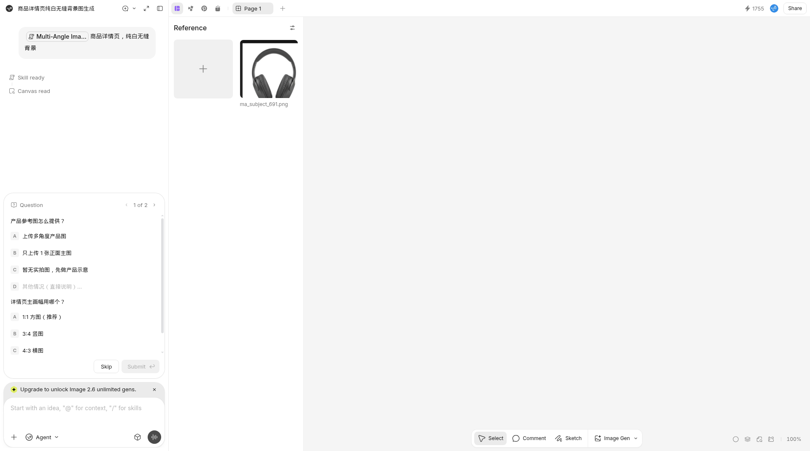
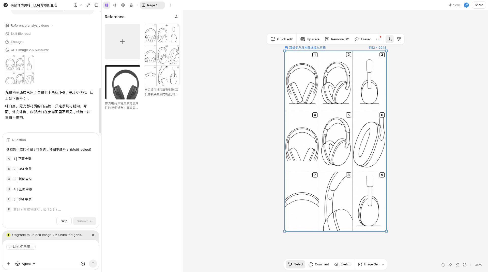
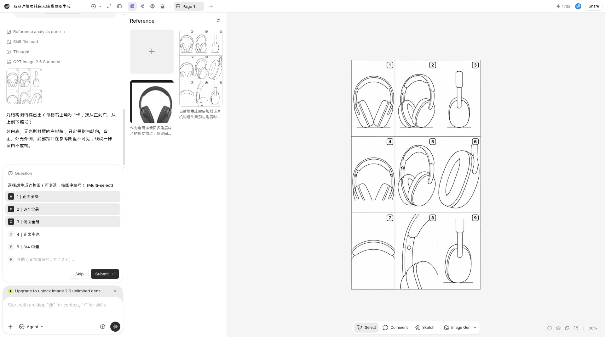
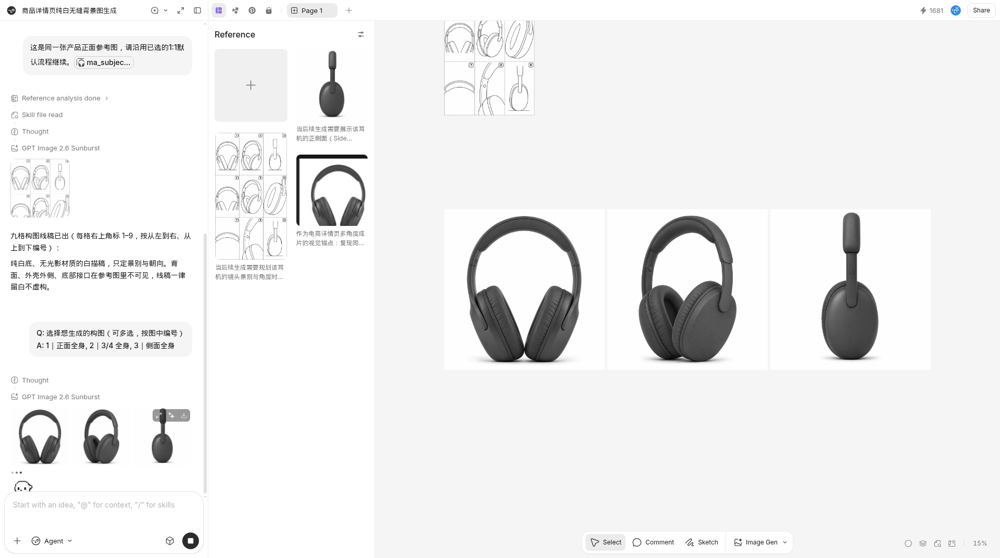

# #911 / #1002 Lovart real-credit multi-angle baseline
Captured 2026-11-16, Asia/Shanghai (UTC+8). Left-side evidence only, **NOT L/R acceptance PASS**.

Project: https://www.lovart.ai/canvas?projectId=2w49x952qnls

Input: ma_subject_691.png + 商品详情页，纯白无缝背景. Skill: universal-multi-angle-grid.

## Observed workflow
One initial submission → reference-source and aspect questions (one front reference, recommended 1:1) → repeat-image request despite existing Reference attachment → same-image reply once → one numbered nine-cell line-art composite (1152×2048 overall, 9:16) → composition multiselect answered 1/2/3 once → three independent 2048×2048 1:1 PNGs (front, three-quarter, side).

Three finals reflect three chosen compositions, NOT a fixed default count. Neither grid nor final dimensions are universal hardcoded specs. Do not replicate the repeated-image request bug in ours. Earlier direct-four-3:4/no-question assumptions are superseded. Subject/earcup depth/button consistency and right-side comparison remain to be verified.

Balance evidence: 1755 → 1738 → 1681; drops of 17 and 57, cumulative 74. These are visible balance changes, not inferred dollar cost or an itemized billing statement. No top-up, regeneration, or initial-task resubmission.

## Main screenshots

## Reuse and traceability
manifest.md is chronological and append-only: earlier state paragraphs are historical; its last section is the completed state. manifest.jsonl preserves browser events. files-sha256.json freezes sizes, hashes and PNG dimensions. Originals prefixed 01-, 02-, 03- are downloaded finals. Reuse these actual outputs for regression; do not repeat paid left-side generation. Full screenshots preserve the attachment issue, selections, and progress.
