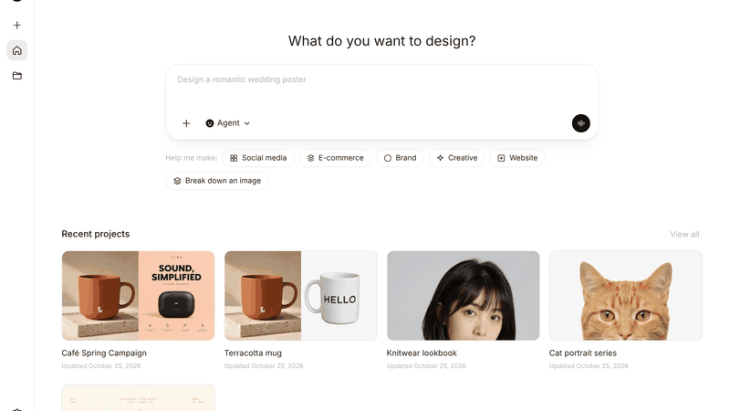

# ComfyArt

English | [中文](README.zh.md)

[](docs/media/promo-en.mp4)

[Watch the full promo (38s)](docs/media/promo-en.mp4)

A free, open-source AI design canvas inside ComfyUI: an infinite canvas (tldraw + React) and a design agent that works on it with tools. Every image, video, audio and 3D job runs on WaveSpeed cloud models; no local GPU or model files are needed.

Documentation with screenshots for every feature: **[comfyart.org](https://comfyart.org)**.


## Features

- **Home and projects**: start a design from one sentence or a skill, browse and manage projects, switch language (中文 / English), theme and chat side at any time.
- **Canvas**: pages, artboards with size presets, fill, stroke and corner radius, auto layout, a layers panel with drag, rename and range select, comments that can be run as edits or sent to the Agent with the marked area, snapshot history, export to PNG, JPG, PDF and editable PPTX.
- **Text and vectors**: rich text (mixed fonts, sizes, colors, bold, italic, underline in one text box), a font picker with brand, common and local fonts, solid, linear, radial and image fills with transparent color stops and blend modes, a pen tool with node editing, and boolean union, subtract, intersect and exclude.
- **Generate**: image generators sized in real pixels with five local image models, references and structure modes, color palettes and base images; video from text, first and last frames, up to 9 reference images, or a storyboard, 5 to 15 seconds at 768p or 1080p.
- **Image tools**: quick edit, upscale, remove background, eraser, crop with platform presets, flip and rotate, non-destructive adjust, inpaint, move object, multi-angle, expand, split layers, edit text, style transfer, vectorize.
- **Edit Elements**: turn a flat poster back into an editable artboard (OCR text layers, cut-out product and logo, clean background), edit it, then re-render.
- **Mockups**: print a design onto a product photo; it follows folds and shading in real time, then bake it or blend it with AI.
- **Audio and 3D**: music, voiceovers (with voice cloning) and sound effects as playable cards; image to textured 3D model.
- **Assets**: My Assets, a full-page brand kit editor, characters, products and a reference board.
- **Agent**: a tool-using design agent (below) that can use every feature above through MCP.

## Install

Put this folder in `ComfyUI/custom_nodes/`, install the Python requirements into ComfyUI's environment (`pip install -r requirements.txt`: `pypdfium2` for PDF uploads and `rapidocr` for Edit Elements), restart ComfyUI and open `http://127.0.0.1:8188/comfyart/`. The built page is in `dist/`; after changing `src/`, rebuild with `npm install && npm run build`.

Projects, their snapshot history and agent chats are saved in a SQLite database, `user/__comfyart/data.db`. Projects from older versions (JSON files under `comfyart/projects/`) are imported automatically the first time you open ComfyArt; the files are left in place. The interface starts in ComfyUI's language and can be switched from the settings menu.

## WaveSpeed cloud models

WaveSpeed is the only generation provider. Create an API key at [wavespeed.ai](https://wavespeed.ai), set it as `WAVESPEED_API_KEY` in the environment before starting ComfyUI, and every canvas action and agent tool sends its job to WaveSpeed. The key is read on the server only and never stored by ComfyArt. Results are downloaded into `output/comfyart/`, so the canvas, history and agent see them like any other image. Jobs estimated at $0.50 or more ask for confirmation first.

Each feature has a default model and a curated list in `api/wavespeed_models.json`; pick another model in the generator, or let the agent pass `model`.

| Feature | Default model |
|---|---|
| `text_to_image` | `alibaba/qwen-image-3.0/text-to-image` |
| `image_edit` | `alibaba/qwen-image-3.0/edit` |
| `change_angle` | `wavespeed-ai/qwen-image/edit-2509-multiple-angles` |
| `expand_image` | `bria/expand` |
| `split_layers` | `bytedance/seedream-v5.0-flash/layer-decomposition` |
| `remove_background` | `wavespeed-ai/image-background-remover` |
| `erase_region` | `wavespeed-ai/image-eraser` |
| `upscale_image` | `wavespeed-ai/image-upscaler` |
| `segment` | `wavespeed-ai/sam3-image` |
| `text_to_video` | `wavespeed-ai/minimax-h3/text-to-video` |
| `image_to_video` | `wavespeed-ai/minimax-h3/image-to-video` |
| `reference_to_video` | `wavespeed-ai/minimax-h3/reference-to-video` |
| `motion_control` | `wavespeed-ai/wan-2.2/animate` |
| `lip_sync` | `wavespeed-ai/infinitetalk-fast` |
| `extend_video` | `wavespeed-ai/minimax-h3/video-extend` |
| `upscale_video` | `wavespeed-ai/video-upscaler` |
| `remove_video_background` | `wavespeed-ai/video-background-remover` |
| `music` | `wavespeed-ai/ace-step-1.5` |
| `sound_effect` | `mirelo-ai/sfx-2.0/text-to-audio` |
| `text_to_speech` | `wavespeed-ai/qwen3-tts/text-to-speech` |
| `voice_clone` | `wavespeed-ai/qwen3-tts/voice-clone` |
| `image_to_3d` | `wavespeed-ai/trellis-2/image-to-3d` |
| `transcribe` | `wavespeed-ai/openai-whisper-turbo` |
| `caption` | `wavespeed-ai/image-captioner` |
| `ocr` | `wavespeed-ai/paddle-ocr` |

## Agent

The Agent panel runs a real tool-using agent on the backend, ported from [ComfyTV](https://github.com/jtydhr88/ComfyTV)'s bot. It is off by default: turn on MCP and the Agent in Agent Settings. Image and video modes work without it. Pick the agent per chat:

| Agent | What it needs |
|---|---|
| Claude Code | `claude` on PATH, logged in |
| Codex | `codex` on PATH, logged in |
| Qwen Code | `qwen` on PATH with a model configured in `~/.qwen/settings.json` |
| DeepSeek Harness | `dsh` on PATH, signed in through the DeepSeek Harness app |
| Local LLM | any OpenAI-compatible endpoint with tool calling (Agent Settings → Local LLM URL); set `COMFYART_LOCAL_LLM_API_KEY` before starting ComfyUI if it needs a key |

Storyboard split, OCR, brand and memory extraction, reference notes and the Ideogram caption are single calls to the default Agent (`POST /comfyart/bot/complete`, no tools). ComfyArt never stores credentials. The agent works through the ComfyArt MCP server at `POST /comfyart/mcp` (look at the canvas, generate and edit images, videos, audio and 3D models, Edit Elements and mockups, place text, shapes, frames, web pages and slides, memory, skills, ask the user). Canvas tools are executed by the open ComfyArt tab of the project, so keep it open while the agent works. Chats are saved in a SQLite database at `user/__comfyart/data.db` and keep running when the panel is closed.

### Use ComfyArt from other agents

Turn on MCP in Agent Settings and add `http://127.0.0.1:8188/comfyart/mcp?project=<project-id>` to any MCP client, for example:

```bash
claude mcp add --transport http comfyart "http://127.0.0.1:8188/comfyart/mcp?project=<project-id>"
codex mcp add comfyart --url "http://127.0.0.1:8188/comfyart/mcp?project=<project-id>"
```

Setup for Claude Code, Codex, Gemini CLI, Qwen Code, Cursor, VS Code, Claude Desktop and your own scripts, tool timeouts and the full tool list are in the [MCP guide](https://comfyart.org/guides/mcp).

## Nodes and routes

- `ComfyArt Precise UNET Loader` loads a diffusion model with manual cast ops. ComfyUI's `--fast fp8_matrix_mult` turns unscaled fp8 checkpoints such as Qwen Image 2512 into noise; this loader skips that path for the model it loads.
- `/comfyart/wavespeed/*` (run, history, cancel, models) submits jobs to WaveSpeed with `WAVESPEED_API_KEY`.
- `/comfyart/bot/*` (chats, send, stop, branch, answers), `/comfyart/settings` and `/comfyart/mcp` serve the Agent.
- `POST /comfyart/pdf` renders up to 30 pages of an uploaded PDF to PNG files in `input/comfyart/pdf/` and returns them with each page's text.
- `POST /comfyart/ocr` reads the text lines of an image (RapidOCR, on device) and returns each line with its box.

## Development

`npm run dev` starts Vite with `/api` proxied to `http://127.0.0.1:8188` (override with `COMFY_URL`).

## License

ComfyArt is MIT licensed. The Agent backend in `bot/` and `api/` is adapted from [ComfyTV](https://github.com/jtydhr88/ComfyTV)'s bot (MIT), including providers co-authored by Pengjingyu1992 (DeepSeek Harness, Local LLM, Codex), MuAIGC (Codex, Qwen Code) and Goldlionren (Codex). The canvas is the [tldraw SDK](https://tldraw.dev), which is not: it is bundled in `dist/` under its own license, copied in `licenses/tldraw-LICENSE.md`. Served from `localhost` or plain `http` it runs in development mode without a license key and shows a small "Get a license for production" badge.
