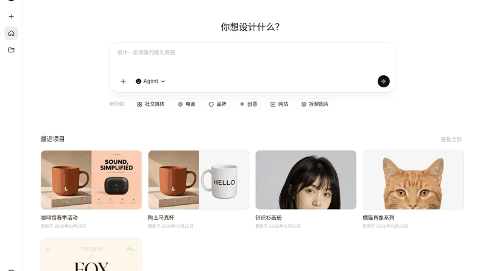

# ComfyArt

[English](README.md) | 中文

[](docs/media/promo-zh.mp4)

[观看完整宣传片（38 秒）](docs/media/promo-zh.mp4)

免费开源的 AI 设计画布，运行在 ComfyUI 里：无限画布（tldraw + React），加上能用工具直接在画布上干活的设计 Agent。所有图像、视频、音频和 3D 任务都跑在 WaveSpeed 云端模型上，不需要本地显卡和模型文件。

每个功能的图文说明见文档站 **[comfyart.org](https://comfyart.org/zh)**。


## 功能

- **首页和项目**：一句话或一个技能就能开始设计，浏览和管理项目，随时切换语言（中文 / English）、主题和对话栏位置。
- **画布**：多页面；画板支持尺寸预设、填充、描边和圆角、自动布局；图层面板可拖动、重命名、范围选择；评论可以直接执行修改，或连同圈出的区域发给 Agent；快照历史；导出 PNG、JPG、PDF 和可编辑的 PPTX。
- **文字和矢量**：富文本（同一个文本框里混用字体、字号、颜色、粗体、斜体、下划线）；字体选择器分品牌、常用和本机字体；纯色、线性、径向和图片填充，色标支持透明度，支持混合模式；钢笔工具和节点编辑；布尔运算（合并、减去、相交、排除）。
- **生成**：按真实像素尺寸出现的图像生成器，五个本地图像模型，参考图和结构模式，配色和底图；视频支持文生视频、首尾帧、最多 9 张参考图和分镜，5 到 15 秒，768p 或 1080p。
- **图片工具**：快捷编辑、放大、去背景、橡皮、带平台预设的裁剪、翻转旋转、非破坏性调整、局部重绘、移动对象、多角度、扩图、图层拆分、编辑文字、风格迁移、矢量化。
- **编辑元素**：把一张成品海报还原成可编辑的画板（OCR 文字图层、抠出的产品和 logo、干净的背景），改完再重新渲染。
- **样机**：把设计印到产品照片上，实时贴合褶皱和光影，然后烘焙成图片或用 AI 融合。
- **音频和 3D**：配乐、配音（支持声音克隆）和音效，以可播放的卡片放在画布上；图片转带贴图的 3D 模型。
- **资产**：我的资产、整页的品牌套件编辑器、角色、产品和参考图板。
- **Agent**：会调用工具的设计 Agent（见下文），通过 MCP 可以使用以上所有功能。

## 安装

**快速启动（不需要显卡，也不需要事先装 ComfyUI）：** 运行 `./scripts/start.sh`，会在 `~/.comfyart-runtime` 装一个 CPU 版 ComfyUI 宿主并启动，打开 `http://127.0.0.1:8188/comfyart/`；再次运行直接启动。也可以用 Docker：`docker build -t comfyart . && docker run -p 8188:8188 -e WAVESPEED_API_KEY=... -v comfyart-user:/opt/ComfyUI/user comfyart`。

装进已有的 ComfyUI：把本目录放进 `ComfyUI/custom_nodes/`，在 ComfyUI 的环境里装好 Python 依赖（`pip install -r requirements.txt`：PDF 上传用的 `pypdfium2`；编辑元素的文字识别走 WaveSpeed 的 `paddle-ocr` 模型，不需要装本地 OCR 包），重启 ComfyUI 后打开 `http://127.0.0.1:8188/comfyart/`。构建好的页面在 `dist/`；改了 `src/` 之后用 `npm install && npm run build` 重新构建。

项目、项目的快照历史和 Agent 对话都保存在 SQLite 数据库 `user/__comfyart/data.db` 里。旧版本的项目（`comfyart/projects/` 下的 JSON 文件）会在第一次打开 ComfyArt 时自动导入，原文件保留不动。界面语言默认跟随 ComfyUI，可以在设置菜单里随时切换。

## WaveSpeed 云端模型

WaveSpeed 是唯一的生成服务。在 [wavespeed.ai](https://wavespeed.ai) 创建 API key，启动 ComfyUI 前把它设成环境变量 `WAVESPEED_API_KEY`，画布上的每个操作和 Agent 工具都会把任务发到 WaveSpeed。key 只在服务端读取，ComfyArt 不保存。结果下载到 `output/comfyart/`，画布、历史和 Agent 看到的和其他图片一样。预估 $0.50 及以上的任务会先弹确认。

每个功能的默认模型和可选模型列表在 `api/wavespeed_models.json` 里；可以在生成卡片里换模型，Agent 也可以传 `model`。

| 功能 | 默认模型 |
|---|---|
| `text_to_image` | `alibaba/qwen-image-3.0/text-to-image` |
| `image_edit` | `alibaba/qwen-image-3.0/edit` |
| `change_angle` | `wavespeed-ai/qwen-image/edit-multiple-angles` |
| `expand_image` | `bria/expand` |
| `split_layers` | `bytedance/seedream-v5.0-flash/layer-decomposition` |
| `remove_background` | `wavespeed-ai/image-background-remover` |
| `erase_region` | `wavespeed-ai/image-eraser` |
| `upscale_image` | `wavespeed-ai/image-upscaler` |
| `segment` | `wavespeed-ai/sam3-image` |
| `text_to_video` | `wavespeed-ai/minimax-h3/text-to-video` |
| `image_to_video` | `wavespeed-ai/minimax-h3/image-to-video` |
| `reference_to_video` | `wavespeed-ai/minimax-h3/reference-to-video` |
| `motion_control` | `wavespeed-ai/wan-2.2/animate` |
| `lip_sync` | `wavespeed-ai/infinitetalk-fast` |
| `extend_video` | `wavespeed-ai/minimax-h3/video-extend` |
| `upscale_video` | `wavespeed-ai/video-upscaler` |
| `remove_video_background` | `wavespeed-ai/video-background-remover` |
| `music` | `wavespeed-ai/ace-step-1.5` |
| `sound_effect` | `mirelo-ai/sfx-2.0/text-to-audio` |
| `text_to_speech` | `wavespeed-ai/qwen3-tts/text-to-speech` |
| `voice_clone` | `wavespeed-ai/qwen3-tts/voice-clone` |
| `image_to_3d` | `wavespeed-ai/trellis-2/image-to-3d` |
| `transcribe` | `wavespeed-ai/openai-whisper-turbo` |
| `caption` | `wavespeed-ai/image-captioner` |
| `ocr` | `wavespeed-ai/paddle-ocr` |

## Agent

Agent 面板在后端运行一个真正会调用工具的 Agent，移植自 [ComfyTV](https://github.com/jtydhr88/ComfyTV) 的 bot。默认关闭：在「Agent 设置」里打开 MCP 和 Agent 即可。图像、视频模式不依赖它。每个对话可以单独选择 Agent：

| Agent | 需要什么 |
|---|---|
| Claude Code | PATH 里有 `claude` 且已登录 |
| Codex | PATH 里有 `codex` 且已登录 |
| Qwen Code | PATH 里有 `qwen`，并在 `~/.qwen/settings.json` 配好模型 |
| DeepSeek Harness | PATH 里有 `dsh`，并在 DeepSeek Harness 应用里登录 |
| ComfyArt Agent（内置，默认） | 用 WaveSpeed Key 调 WaveSpeed 上的 DeepSeek v4.1 flash；也可换成任意支持工具调用的 OpenAI 兼容端点（Agent 设置 → 模型地址、模型名、API Key；也可用 `COMFYART_LOCAL_LLM_API_KEY`） |

智能分镜、OCR、品牌和记忆提取、参考图说明、Ideogram 的结构化描述，都是对默认 Agent 的单次调用（`POST /comfyart/bot/complete`，不带工具）。ComfyArt 从不保存任何凭据。Agent 通过 `POST /comfyart/mcp` 上的 ComfyArt MCP 服务器干活（查看画布、生成和编辑图片、视频、音频和 3D 模型、编辑元素和样机、放置文字、形状、画板、网页和幻灯片、记忆、技能、向用户提问）。画布工具由该项目打开着的 ComfyArt 标签页执行，所以 Agent 工作时请保持页面打开。对话保存在 SQLite 数据库 `user/__comfyart/data.db` 里，关掉面板也会继续运行。

### 在其他 agent 里使用 ComfyArt

在「Agent 设置」里打开 MCP，把 `http://127.0.0.1:8188/comfyart/mcp?project=<项目 id>` 加到任意 MCP 客户端，例如：

```bash
claude mcp add --transport http comfyart "http://127.0.0.1:8188/comfyart/mcp?project=<项目 id>"
codex mcp add comfyart --url "http://127.0.0.1:8188/comfyart/mcp?project=<项目 id>"
```

Claude Code、Codex、Gemini CLI、Qwen Code、Cursor、VS Code、Claude Desktop 和自写脚本的接入方法、工具超时设置以及完整工具列表见 [MCP 指南](https://comfyart.org/zh/guides/mcp)。

## 节点和路由

- `ComfyArt Precise UNET Loader` 用 manual cast 算子加载扩散模型。ComfyUI 的 `--fast fp8_matrix_mult` 会把 Qwen Image 2512 这类未缩放的 fp8 权重跑成噪点；这个加载器让它加载的模型绕开那条路径。
- `/comfyart/wavespeed/*`（run、history、cancel、models）用 `WAVESPEED_API_KEY` 把任务提交到 WaveSpeed。
- `/comfyart/bot/*`（对话、发送、停止、分支、回答）、`/comfyart/settings` 和 `/comfyart/mcp` 服务于 Agent。
- `POST /comfyart/pdf` 把上传的 PDF 前 30 页渲染成 PNG，存到 `input/comfyart/pdf/`，并连同每页文字一起返回。
- `POST /comfyart/ocr` 用 WaveSpeed 的 `paddle-ocr` 模型识别图片里的文字行（需要 WaveSpeed Key），返回每行文字和位置框。

## 开发

`npm run dev` 启动 Vite，`/api` 代理到 `http://127.0.0.1:8188`（可用 `COMFY_URL` 覆盖）。

## 许可证

ComfyArt 采用 MIT 许可证。`bot/` 和 `api/` 里的 Agent 后端改编自 [ComfyTV](https://github.com/jtydhr88/ComfyTV) 的 bot（MIT），其中包括 Pengjingyu1992（DeepSeek Harness、Local LLM、Codex）、MuAIGC（Codex、Qwen Code）和 Goldlionren（Codex）共同编写的 provider。画布使用的 [tldraw SDK](https://tldraw.dev) 不是 MIT：它以自身的许可证打包在 `dist/` 中，许可证副本见 `licenses/tldraw-LICENSE.md`。从 `localhost` 或普通 `http` 访问时，它以开发模式运行，无需许可证密钥，右下角会显示一个小的 "Get a license for production" 标记。
