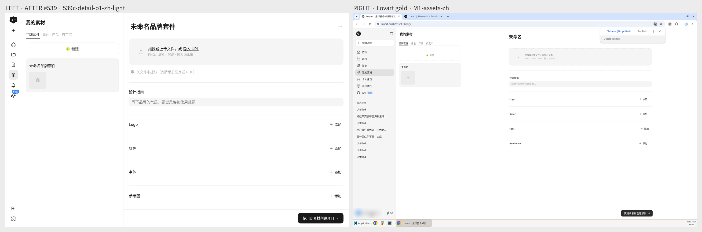
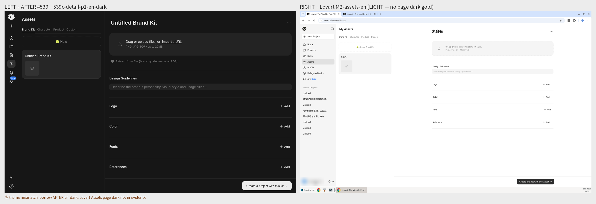
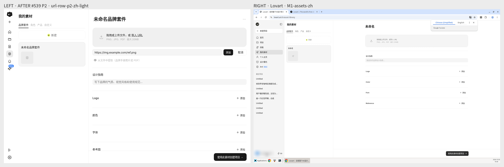
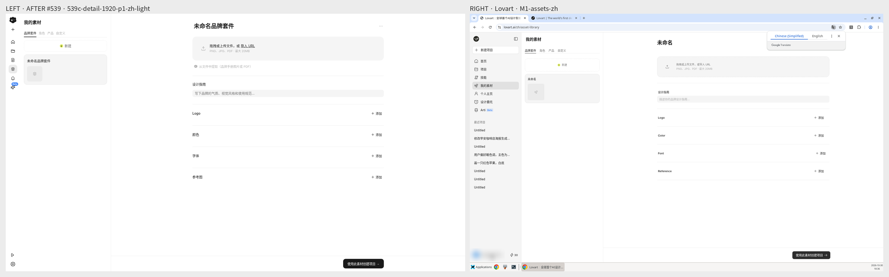

📌 设计 soft L/R pin — #497 residual visual **1:1** per [6573000359](https://github.com/ganjmeng/ComfyArt/issues/497#issuecomment-6573000359)（2026-11-02 Asia/Shanghai）

**Pin:** branch [`assets/497-visual-lr`](https://github.com/ganjmeng/ComfyArt/tree/fe4b2a1551568686cf1b158ef1cfad0ab5540632/assets/497-visual-lr) @ `fe4b2a1551568686cf1b158ef1cfad0ab5540632`  
**LEFT = AFTER #539** detail（`539c-*`）· **RIGHT = Lovart** M1/M2（旧证据；**未**盲爬 lovart.ai）  
**勿**用 main-66dbb4e KitEditor-as-only-surface 当 LEFT。

### SBS

### Concrete gaps → 请产品锁 tip AC
1. **列表列宽** — Lovart 分隔 ≈159px @1280；我们 ≈439px（列表过宽）
2. **列表列底色** — Lovart `#f5f5f5`；我们空区 `#ffffff`（与详情白底弱对比）
3. **上传区** — AFTER 已是实心 fill（旧虚线残差看起来 P2 已关）；仍多「从文件中提取…」副行；标题→上传区间距/高度未对齐 M1
4. **标题行** — 默认名「未命名品牌套件」vs Lovart「未命名」；顶 padding 更大
5. **Logo/Color/Font/Reference 行距** — 我们行更高/更疏；**「+ 添加」已 P2 修好**，勿再 tip 有无
6. **底栏 CTA** — 文案已齐；条高度/左右 inset/按钮重量对齐 M1
7. **「新建」铬**（可选 soft）— Lovart 虚线创建；我们实线+黄加号
8. **Dark** — 无 Lovart 页深色金标；借用 AFTER en-dark（SBS 已标 theme mismatch）

完整表：[`GAP.md`](https://raw.githubusercontent.com/ganjmeng/ComfyArt/fe4b2a1551568686cf1b158ef1cfad0ab5540632/assets/497-visual-lr/GAP.md)

### Out（本 soft 不写 tip）
- **filter / 搜索** — 页金标无；不发明
- **preview / download** — M1/M2 与本 L/R **未**打开 Lovart 卡片「…」量到这两项 → **out**；若后续 L/R 量到再钉，否则另卡

### 流程
@产品 据本 pin 锁 tip AC → 全栈 tip（`Closes #497`）。设计不 tip PR。全栈等产品 lock。
