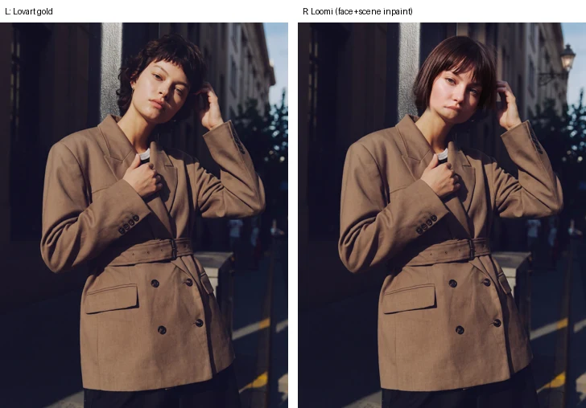

# #643 Wash SOP（示例图洗图规范）

本规范适用于 skill 的 cover / examples / featured 示例图洗图（kie i2i）。按**槽位类型**分两套规则，先判断槽位属于哪一类，再按对应规则做。

---

## A. 人物 / 照片类槽位（person / photo）

适用：画面主体是真人照片的槽位，例如 pose-fission、ai-model、portrait 类。

### 方法：以金标为底图的局部重绘
1. **底图 = 金标**。用 kie（`gpt-image-2-5-flare-image-to-image`）对金标做一次编辑：只换脸，外加 1–2 处小场景细节。
2. 用**羽化遮罩**合成（Pillow/numpy），只贴回：
   - **脸/头发**：椭圆遮罩做高斯羽化，再乘一条在**领口线处降到 0** 的竖向渐变（约 40px）。衣服像素一个也不进遮罩。
   - **1–2 个小场景框**：羽化只做在框内，框不能碰衣服。
3. 遮罩以外的像素**全部是金标原像素**：衣服、姿势、光线、调色、颗粒都不动。验收时在 PNG 母版上确认：遮罩为 0 的像素与金标**逐字节相同**。

### 换脸要求
- 必须是**另一个人**，半屏一眼能分辨；颜值不低于金标。
- **头部角度、视线、受光方向**跟金标一致；发丝边缘干净，没有羽化晕边。
- **连续性槽位**（如 pose-fission）：所有示例用**同一张新脸**。从第一张成品取人物参考（multi-ref Image 2）。
- **ai-model 类槽位**：每个示例换**不同的人**，各自匹配对应金标的族裔和风格。

### 色调与颗粒（硬指标）
- **脸部亮度**（遮罩 > 0.5 区域的平均亮度）与金标之差必须在 **±5** 以内，目标 **±3**。做法：合成前给编辑图乘增益 `gain = mean(L_gold) / mean(L_edit)`。
- **暗部颗粒**要和金标一致。指标是脸部暗部（遮罩 > 0.5 且 L < 70）的 high-pass（σ=2）std，成品对金标。编辑图颗粒偏粗时降低其高频；偏细时在遮罩内补单色噪声。
- **meanAbs 只做记录**，不作为门槛。

### 场景细节
- **整块替换**场景物体，不要叠加在原物体上。例如把整块排水篦子（连框带花纹）换成铺地砖，而不是在篦子里叠一个圆井盖。
- 金标里的文字要清掉。成品不得出现任何文字、logo、数字。

### 遮罩的坑（#670 经验）
- **不要用硬边的排除矩形**。#670 ex04 的袖口排除矩形在 y≈420 留下一条硬横线：上面是重绘过的偏亮背景，下面是偏暗的金标，发梢被齐刷刷截断。要排除衣服，就用领口线渐变；确实需要排除的区域必须有大羽化，或把边放到头发/手的下方。
- 场景框的羽化要留在框内。贴回的内容要与周围景深一致，必要时对场景源做轻微模糊。

### 流程
1. **每个新槽位先做 1 张 pilot**，通过后再做其余。
2. 每张最多 2 次 kie；余额低于 300 停止。
3. 在 PR 里报告每张的**重绘面积 %**（遮罩 > 0.02 的像素占全画面比例，分脸/发与场景框，再给一个加权值）。

### 参考：#670 pose-fission ex04

#670 的结果：重绘面积 3.9%–10.6%；脸部亮度差 −1.26 到 +0.27；暗部颗粒与金标相差不超过 0.4；衣服 100% 是金标原像素。遮罩参数记在 `docs/design/643/wash-manifest.pose-fission.json`。

---

## B. 商品 / 海报 / 文字类槽位（product / poster / text）

沿用现有规则：
- **真洗（true wash）**：成品要能和金标区分开，但构图保持一致。
- **不得原样复制金标**。只做轻度重编码、近乎原图的版本不算洗图，会被拒（参见 `643/wash/thumbnail/README.md`）。
- 文字、logo 要重写或清除，不得照抄金标。

---

## PR body 检查清单（两类通用）
- [ ] L/R 对比图链接固定在 **tip 完整 SHA**（40 位），逐个确认 HTTP 200
- [ ] `src/skills.ts` 的 `ex643(...)` pin 用资源提交的**完整 SHA**
- [ ] 每个示例的自检：换人/真洗是否成立；人物类写清重绘面积 %、衣服是否 100% 金标、场景框、脸部亮度差、暗部颗粒；sha256；meanAbs（仅记录）
- [ ] manifest 已更新：方法、遮罩参数、prompt，不留旧描述
- [ ] 门禁：tsc OK · unit（`skill and not e2e`）0 failed · build OK（dist 不提交）· e2e（`(skill and e2e) or 650 or creator`）全过
- [ ] kie 调用次数与余额
- [ ] PR 保持 draft；同一时间只能有一个 PR 处于 Ready
