# #687 Phase1 re-audit — main 0ae75b07 (review only, no generation) — rev 3
Evidence: lr/<id>.png (L = Lovart, R = ComfyArt cover + featured + examples/presets).
Lovart refs: gold_lovart/<id>/ (box-local, not committed) (cover, exNN, dialog.png) for banner, brand, character, interior, logo-material, marketing-campaign, meta-ads, packaging, poster, social, web-product; 640 dialog (thumbnail); 494 Amazon 商品主图 modal (product); 570 canvas (multi-angle); skills-page crops (motion, mobile-ui).
Matching caveats: character = "Character Sheet Design" (alternatives exist); social = "instagram Product Post" (#592 maps social to 小红书封面 — mapping to confirm); logo-material Lovart cover = ex01; brand = "Brand Identity" (earlier ref was 标志系统); packaging = "Packaging Design".

| id | verdict | issues (severity) | count ours/Lovart (#687-1) | fields ours vs Lovart (#687-3) | evidence | unwashed check (64² gray MAD ≤7) | resolution vs gold |
|---|---|---|---|---|---|---|---|
| product | FIX | cover A+ lifestyle strip vs Amazon white-bg grid (d,M); featured multi-brand + portrait (b,M); presets OK | 6/6 ✅ | 商品图片*/商品资料/视觉呈现方式 = Lovart ✅ | [lr/product.png](https://github.com/ganjmeng/ComfyArt/blob/<SHA>/docs/qa/687-audit/lr/product.png) | n/a (gold = 494 SBS composite; min 29.3) | n/a |
| multi-angle | PASS | portrait frames near-frontal (#708,L) | canvas tool, n/a | Upload+Additional ✅ | [lr/multi-angle.png](https://github.com/ganjmeng/ComfyArt/blob/<SHA>/docs/qa/687-audit/lr/multi-angle.png) | n/a (no gold images) | n/a |
| brand | FIX | Lovart = immersive brand worlds (billboard, apparel, apps, packaging); ours presets = logo boards only (d,M); featured multi-brand/poster drift (b,M) | 6/11 ❌ | 3 (brandInfo*/brandAssets/visual) vs 2 ❌ | [lr/brand.png](https://github.com/ganjmeng/ComfyArt/blob/<SHA>/docs/qa/687-audit/lr/brand.png) | ✅ 0 flagged; min 21.3 (pre_foodbev.webp↔ex11.webp) | ❌ 10/10 below gold long side; AR≠ 9/10 |
| packaging | RE-WASH | cover still carries “LUMIERE ARTISAN” (494 Lovart ref brand) + near-copy composition = soft-wash (a,H); featured lifestyle multi-brand (d,M); presets clean | 5/8 ❌ | 3 (packInfo/packAssets/visual) vs 2 ❌ | [lr/packaging.png](https://github.com/ganjmeng/ComfyArt/blob/<SHA>/docs/qa/687-audit/lr/packaging.png) | ✅ 0 flagged; min 28.6 (pre_eco.webp↔ex02.webp) | ❌ 8/9 below gold long side; AR≠ 8/9 |
| character | FIX | family OK (turnaround/expression sheets) but single model ×8 vs Lovart 6 varied subjects (real/anime/rogue/magical girl), not 1:1 (d,M); featured multi-brand (b,M) | 8 presets/6 ❌ | 3 (characterRef/characterInfo/visual) vs 2 ❌ | [lr/character.png](https://github.com/ganjmeng/ComfyArt/blob/<SHA>/docs/qa/687-audit/lr/character.png) | ✅ 0 flagged; min 36.9 (pre_01.webp↔ex01.webp) | ❌ 12/12 below gold long side; AR≠ 8/12 |
| logo-material | FIX | same family (3D material on logo) but not washed from Lovart (chrome/iridescent “K” on black) (c,M) | 4/3 ❌ | 3 (logoImage*/materialNotes/visual) vs 2 ❌ | [lr/logo-material.png](https://github.com/ganjmeng/ComfyArt/blob/<SHA>/docs/qa/687-audit/lr/logo-material.png) | ✅ 0 flagged; min 42.3 (ex04.webp↔ex02.webp) | ❌ 8/8 below gold long side; AR≠ 2/8 |
| motion | RE-WASH | Lovart ref = “Reference Video Remake” (alt: UGC Ad Video Director): 1 example (remake of curly-hair model). Our featured03 IS that Lovart remake with original face kept (c,H); our presets = poster-animation/first-last (LUMEN DRIFT) + STARFALL/car/RESONANCE featured = different topic from Remake/UGC (d,H) — decide mapping first | 2 presets/1 ❌ | 3 (stillArt*/motionNotes/visual) vs 5 (template select / Reference video* / Remake brief* 200 / Replacement images / Visual direction 200) ❌ | [lr/motion.png](https://github.com/ganjmeng/ComfyArt/blob/<SHA>/docs/qa/687-audit/lr/motion.png) | ✅ 0 flagged; min 64.8 (feat03.webp↔cover_f0.jpg) | ❌ 1/6 below gold long side; AR≠ 4/6 |
| meta-ads | RE-WASH | Lovart = multi-option ad boards (Option 1/2/3, phone mockups, varied brands); ours = single AQUA PEAK creatives, different layout family, no gold base (c/d,H) | 4/4 ✅ | 3 (campaignBrief*/adAssets/visual) vs 2 ❌ | [lr/meta-ads.png](https://github.com/ganjmeng/ComfyArt/blob/<SHA>/docs/qa/687-audit/lr/meta-ads.png) | ✅ 0 flagged; min 49.3 (ex01.webp↔ex02.webp) | ❌ 8/8 below gold long side; AR≠ 8/8 |
| poster | PASS | examples are 1:1 washes of Lovart 5 (なつのおわりに/2x1 drink/LAS MAREAS/safety/synthwave); cover grid ≠ Lovart “solstice” cover (L) | 5/5 ✅ | EFFECT_INPUTS structure ✅; EN copy differs (L) | [lr/poster.png](https://github.com/ganjmeng/ComfyArt/blob/<SHA>/docs/qa/687-audit/lr/poster.png) | ✅ 0 flagged; min 8.2 (ex03.webp↔ex03.webp) ⚠ borderline | ❌ 5/9 below gold long side; AR≠ 8/9 |
| thumbnail | PASS | feat643/ex643 = Lovart base + face swap + brand labels removed | 6/6 ✅ | Upload+Additional ✅ | [lr/thumbnail.png](https://github.com/ganjmeng/ComfyArt/blob/<SHA>/docs/qa/687-audit/lr/thumbnail.png) | ✅ 0 flagged; min 34.2 (feat643_01.webp↔thg_main.png) | ✅ 0/11 below gold long side; AR≠ 6/11 |
| mobile-ui | FIX | family OK (phone-framed UI) but Lovart = 13 multi-screen flows across apps/watch/a11y annotations; ours = 4 Lumen Habit screens, not washed from Lovart (c,M) | 4/13 ❌ | 3 (appBrief*/uiRefs/visual) vs 2 ❌ | [lr/mobile-ui.png](https://github.com/ganjmeng/ComfyArt/blob/<SHA>/docs/qa/687-audit/lr/mobile-ui.png) | ✅ 0 flagged; min 15.7 (feat03.webp↔ex09.webp) | ❌ 8/8 below gold long side; AR≠ 8/8 |
| social | RE-WASH† | vs “instagram Product Post” (big type behind product): ours = 小红书 lifestyle covers, different topic (d,H). † conditional on mapping — if Lovart 小红书封面 is the correct ref, re-judge | 10/5 ❌ | 4 (file/productRef/personRef/note) vs 2 ❌ | [lr/social.png](https://github.com/ganjmeng/ComfyArt/blob/<SHA>/docs/qa/687-audit/lr/social.png) | ✅ 0 flagged; min 47.7 (cover.webp↔ex01.png) | ❌ 14/14 below gold long side; AR≠ 8/14 |
| marketing-campaign | RE-WASH | Lovart = 8 multi-frame campaign strips (5 frames each, different brands); ours = 4 single YORI frames, different layout family, no gold base (c/d,H) | 4/8 ❌ | 3 (campaignGoal*/campaignAssets/visual) vs 2 ❌ | [lr/marketing-campaign.png](https://github.com/ganjmeng/ComfyArt/blob/<SHA>/docs/qa/687-audit/lr/marketing-campaign.png) | ✅ 0 flagged; min 43.1 (ex02.webp↔ex03.webp) | ❌ 8/8 below gold long side; AR≠ 8/8 |
| web-product | FIX | family OK (web UI/dashboards) but not washed from Lovart (c,M) | 4/9 ❌ | 3 (webBrief*/webRefs/visual) vs 2 ❌ | [lr/web-product.png](https://github.com/ganjmeng/ComfyArt/blob/<SHA>/docs/qa/687-audit/lr/web-product.png) | ✅ 0 flagged; min 16.0 (ex02.webp↔ex03.webp) | ❌ 7/8 below gold long side; AR≠ 6/8 |
| banner | FIX | ex01 = true wash of Lovart fintech banner ✅; cover VENTUR brand board vs Lovart fintech banner cover (d,M); featured multi-brand (b,M) | 1/1 ✅ | EFFECT_INPUTS ✅; EN copy differs (L) | [lr/banner.png](https://github.com/ganjmeng/ComfyArt/blob/<SHA>/docs/qa/687-audit/lr/banner.png) | ✅ 0 flagged; min 68.6 (feat01.webp↔cover.jpg) | ❌ 1/5 below gold long side; AR≠ 3/5 |
| interior (untouched) | RE-WASH | Lovart “Scene Photo to Interior Render” = same room variants; ours = different moody rooms + moodboard (d,H) | 4/2 ❌ | EFFECT_INPUTS ✅; EN copy differs (L) | [lr/interior.png](https://github.com/ganjmeng/ComfyArt/blob/<SHA>/docs/qa/687-audit/lr/interior.png) | ✅ 0 flagged; min 51.7 (cover.webp↔cover.png) | ❌ 8/8 below gold long side; AR≠ 7/8 |

## Objective checks (steering 2)
(a) Unwashed: each of our cover/featured/example/preset images vs every Lovart gold image of the card (gold_lovart cover+exNN+video first frames _f0/_frame; thumbnail = 640 dialog + cover), 64×64 grayscale mean abs diff (0–255). Flag ≤7. **Result: 0 pairs flagged on any card.** Closest pairs: poster ex03↔ex03 8.2 (borderline, real wash w/ copy changed), poster ex04↔ex04 15.1, mobile-ui feat03↔ex09 15.7, web-product ex02↔ex03 16.0, brand pre_foodbev↔ex11 21.3. motion feat03↔cover 64.8 (recomposed crop; visual note: original Lovart face kept — metric can't catch crop/AR-changed copies).
(b) Resolution: our long side vs best-match gold long side, aspect ratio diff >0.05. Our 462px list covers excluded (by design). Most cards ❌: our 1024–1376px vs Lovart 1254–4106px. Thumbnail ✅ (1600 ≥ 716/1040). Banner 1/5, motion 1/6 below. Caveat: some golds are page captures (e.g. poster ex04 240px), so resolution is indicative; AR mismatch mainly portrait 3:4/9:16 vs Lovart 16:9 boards (meta-ads, mobile-ui, marketing-campaign 8/8).

## Counts
PASS 3 (multi-angle, poster, thumbnail) / FIX 7 (product, brand, character, logo-material, web-product, mobile-ui, banner) / RE-WASH 6 (packaging, motion, meta-ads, social†, marketing-campaign, interior). Total 16.
Criterion 1 count match: ✅ product, poster, thumbnail, meta-ads, banner; ❌ brand, packaging, character, logo-material, social, marketing-campaign, web-product, interior; ❌ also mobile-ui (4/13), motion (2/1); n/a multi-angle.

## Field PR list (#687-3) — source: gold_lovart/<id>/ (box-local, not committed)dialog_fields.txt. Lovart = Upload Files (optional) + Additional Details (optional, “Anything else to add?”, max 500) on 12 cards; motion differs
- brand: brandInfo* / brandAssets / visual → file + note
- packaging: packInfo / packAssets / visual → file + note
- character: characterRef / characterInfo / visual → file + note
- logo-material: logoImage* / materialNotes / visual → file + note
- meta-ads: campaignBrief* / adAssets / visual → file + note
- marketing-campaign: campaignGoal* / campaignAssets / visual → file + note
- web-product: webBrief* / webRefs / visual → file + note
- social: file / productRef / personRef / note → file + note
- copy-only (L): poster, banner, interior use EFFECT_INPUTS (EN “Upload file / Additional notes / Anything you want to add?”) → NEARMISS_INPUTS matches Lovart wording exactly
- mobile-ui: appBrief* / uiRefs / visual → file + note
- motion: stillArt* / motionNotes / visual → Lovart Remake: template select + Reference video* (upload) + Remake brief* (text, 200) + Replacement images (upload, opt) + Visual direction (text, 200) — only if motion stays mapped to Reference Video Remake
- all 2-field cards: note maxlength 500, both optional (ours marks brandInfo/packInfo… required)
- product: keep (matches Lovart Amazon 3 fields). thumbnail, multi-angle: OK.

## #708 mapping
Targets Phase3 (ai-model, studio-model, clothing-swap, before-after, taobao-product 买一送一) → no Phase1 blocker. Angle rule reminder: multi-angle portrait frames, character, social.

## 群版（中文）
#687 Phase1 复审 @0ae75b07（只审不生成，13 张卡已用 Lovart 真金标+弹窗字段逐卡对比）
16 张卡：PASS 3 / FIX 7 / RE-WASH 6
🔴 RE-WASH
- packaging：封面仍有 Lovart 品牌「LUMIERE ARTISAN」=软洗；示例 5 vs 8
- motion：对标「参考视频重制」，精选03 就是 Lovart 重制图原脸未换；我们预设是海报动画，题材不符，需先定对标卡
- meta-ads：Lovart 多方案广告板，我们单张水壶图
- marketing-campaign：Lovart 8 组多帧战役条，我们 4 张单帧
- social†：对标「instagram Product Post」题材不符（若应对标小红书封面需改判）；10 vs 5
- interior：Lovart 同一房间照片转渲染，我们不同房间；4 vs 2
🟡 FIX
- product：封面/精选非白底主图+多品牌（6=6、字段一致 ✅）
- brand：只有 Logo 板，缺品牌世界延展；6 vs 11
- character：同一模特 8 张 vs Lovart 6 种角色
- logo-material 4 vs 3、web-product 4 vs 9、mobile-ui 4 vs 13：同类但非金标洗图
- banner：示例 1=1 真洗 ✅，封面/精选跑题
🟢 PASS：thumbnail、poster（5=5 真洗）、multi-angle
客观检查(a) 未洗图（64×64 灰度均差≤7）：全部 0 张命中；最接近 poster ex03 8.2（临界，文案已换）；motion 精选03 因裁切比例不同得分 64.8，需人工判定原脸
客观检查(b) 分辨率：除 thumbnail（1600）外，多数卡长边 1024–1376 低于 Lovart 1254–4106；meta-ads/mobile-ui/marketing-campaign 比例 8/8 不一致
字段（第3条）：Lovart 12 张卡均为「上传文件+补充说明(500字)」，均选填
需改：brand/packaging/character/logo-material/meta-ads/marketing-campaign/web-product/mobile-ui/social；poster/banner/interior 仅英文文案差
motion：Lovart 为模板+参考视频*+重制说明*+替换图+视觉方向，待定对标后改
#708：针对 Phase3，对 Phase1 无阻塞
对比图与清单：docs/qa/687-audit/（本地 commit，未推送）

## Embeds
### banner
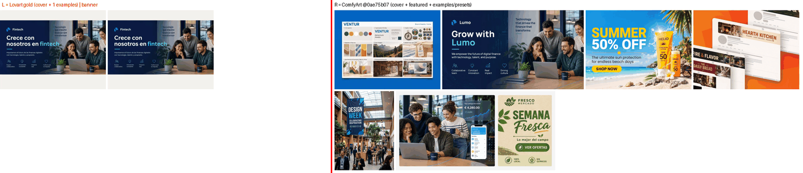
### brand
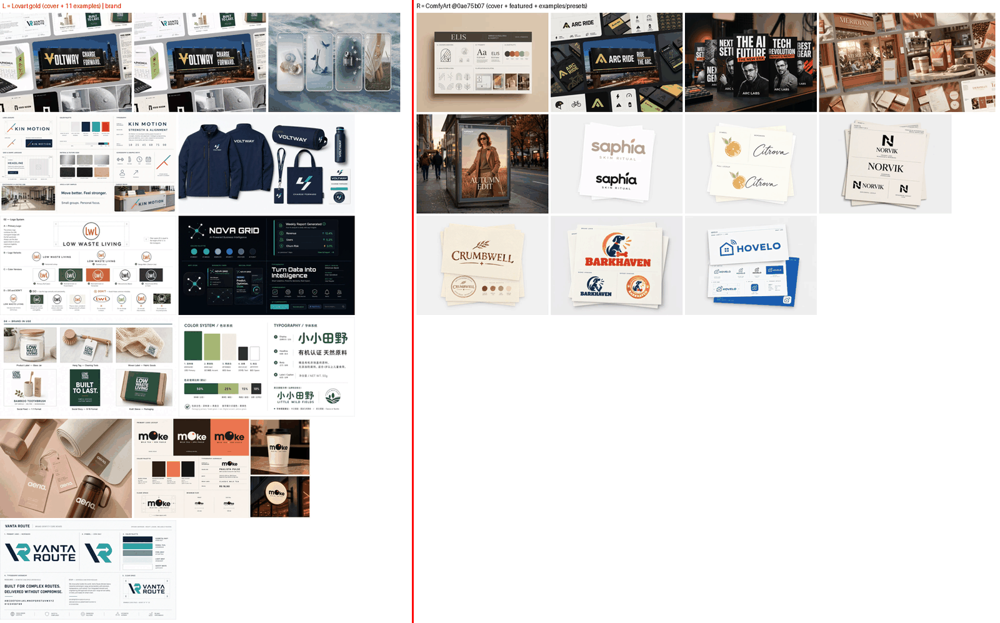
### character
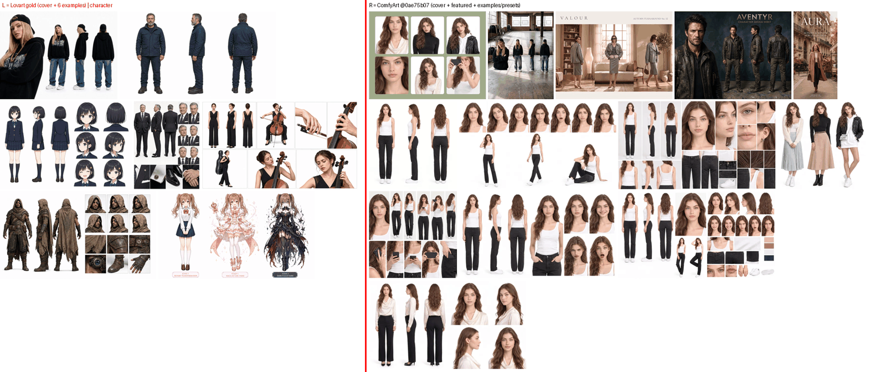
### interior
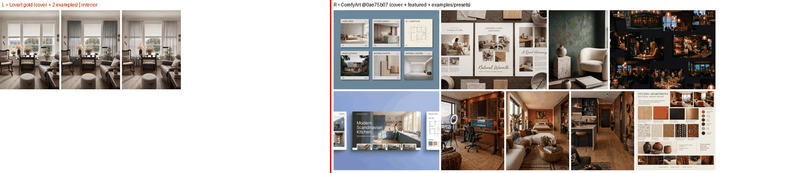
### logo-material
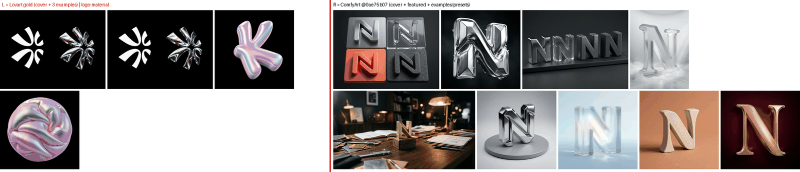
### marketing-campaign
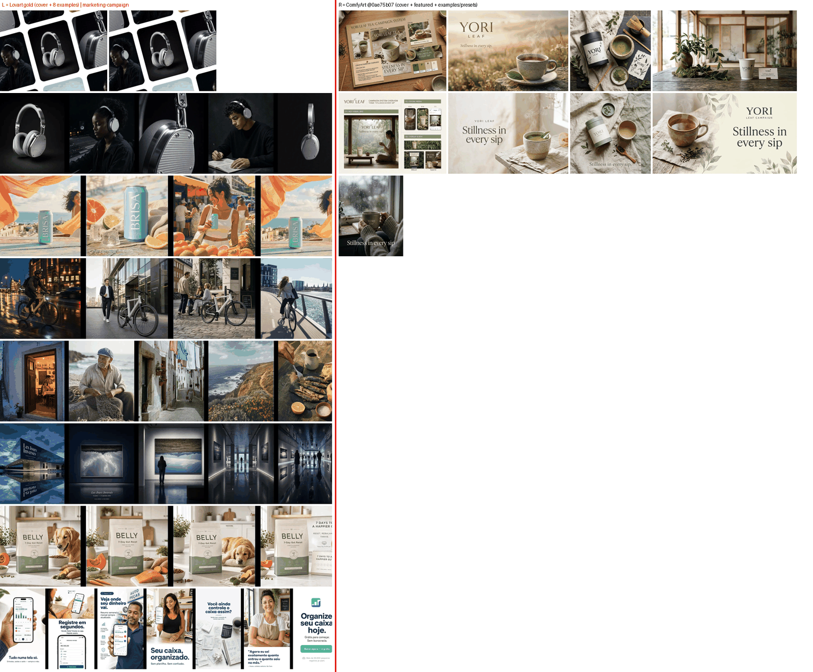
### meta-ads
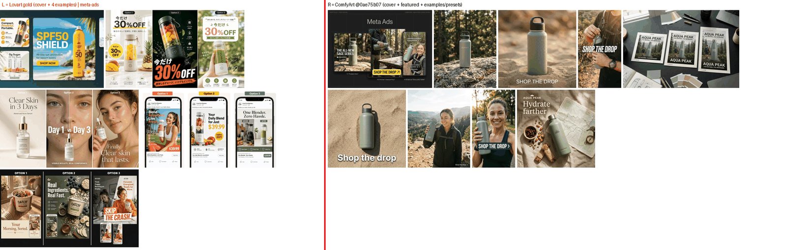
### mobile-ui
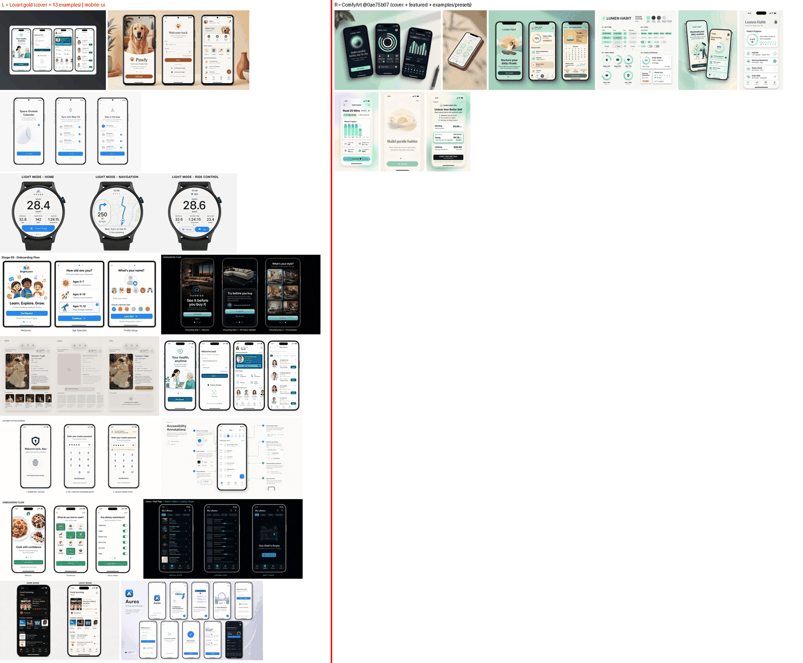
### motion
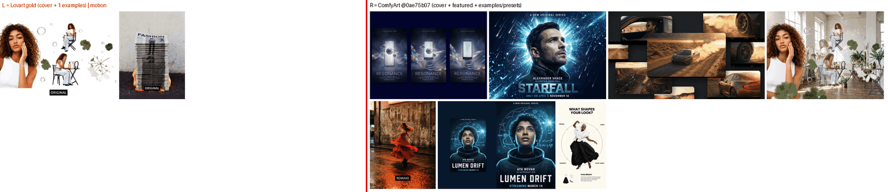
### multi-angle
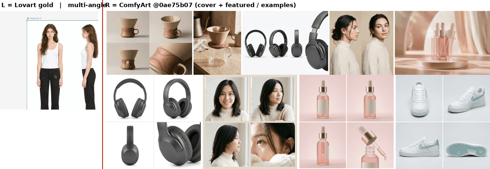
### packaging
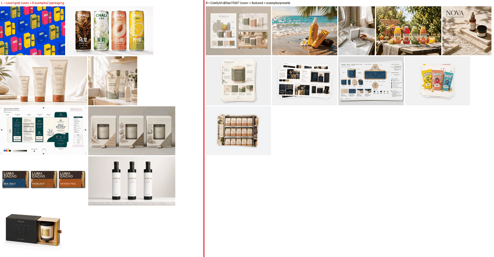
### poster
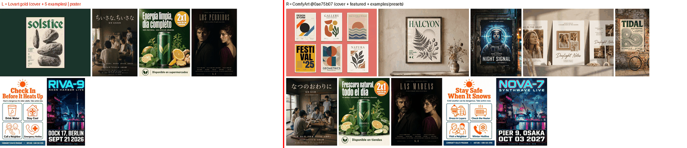
### product
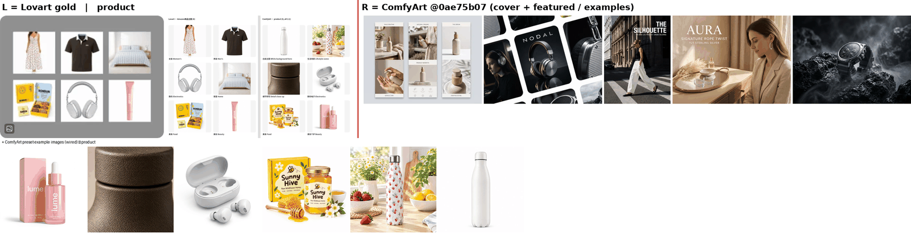
### social
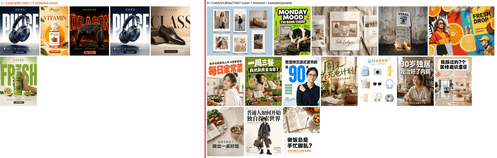
### thumbnail
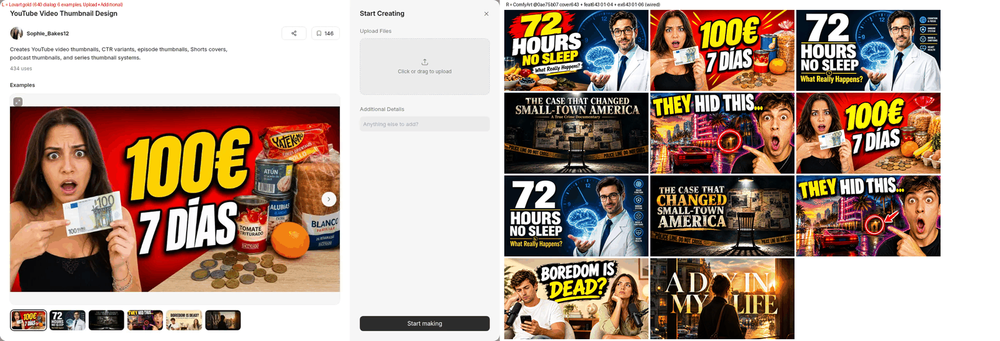
### web-product
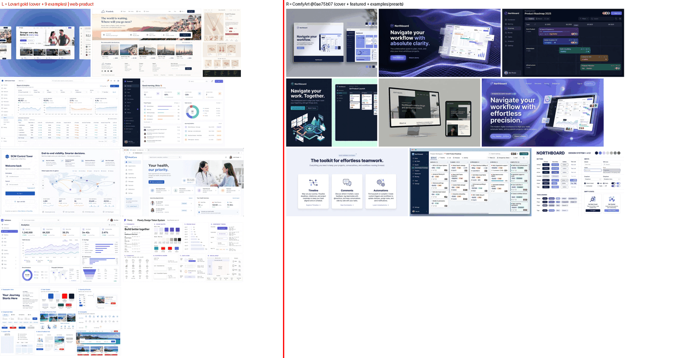

Per-image data: objective_checks.csv
